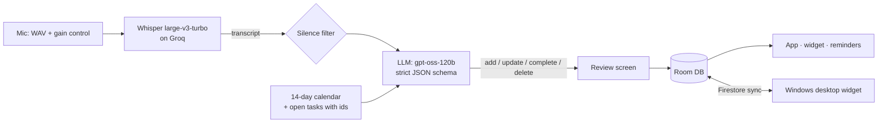

# Dictask: say it once, it's on your list

**The problem:** tasks pop into your head while you're walking, cooking or driving. Typing them into a
to-do app with dates, times and lists is slow enough that you don't, and then they're forgotten.

**The solution:** press one button and talk the way you'd talk to a person:

> *"Call the electrician tomorrow at 10, buy milk and eggs tonight, and pay the credit card bill by
> Friday, it's urgent"*

Dictask turns that into **three separate tasks**, each with its own date, time and reminder, the last one
marked high priority. It also understands edits: *"move the dentist to Friday"*, *"I've paid the rent"*
and *"delete the milk one"* change the tasks you already have.

It runs on **Android** (app, home-screen widget, quick-settings tile) and **Windows** (a transparent
desktop widget), synced live between them.

<p align="center"></p>

| First run | One sentence → 3 tasks | Sorted by when | "Move it to Saturday" |
|---|---|---|---|
|  |  |  |  |

| Windows app | Floating desktop widget |
|---|---|
|  |  |

---

## Get started in 2 minutes

**1. Download** from the [latest release](https://github.com/HEMANTHreddysolipeta/dictask/releases/latest):

| Platform | File | Install |
|---|---|---|
| Android 8+ | `Dictask-1.0.0-android.apk` | Open the file on your phone and allow "install unknown apps" when asked. If Play Protect warns, tap **More details → Install anyway** (it's not from the Play Store yet). |
| Windows 10/11 | `Dictask-1.0.0-windows-x64.zip` | Unzip anywhere and run `Dictask.exe`. If SmartScreen appears, click **More info → Run anyway** (the app isn't code-signed yet). |

**2. Get your free Groq key** (Groq runs the speech and AI models; the free tier is plenty for personal use):

1. Go to **[console.groq.com/keys](https://console.groq.com/keys)** and sign in (Google sign-in works, no card needed)
2. Click **Create API Key**, give it any name, and copy it (it starts with `gsk_`)

**3. Paste it into Dictask.** The app shows a "Set up voice in 1 minute" card on first launch; paste the key and
press **Check & save**. Dictask tests the key with Groq before saving it, so a wrong key is caught right away.

That's it: tap the mic (phone) or press **Ctrl+Shift+Space** anywhere (Windows) and say your tasks.

**Accounts and sync.** The phone app works without an account. The Windows app asks you to create a free Dictask
account (email + password) on first launch, because its tasks are stored in the cloud. To see the same tasks on your
phone, sign in with that account under **Settings → Sync with laptop**. Your tasks are private to your account.

---

## How it works



1. **Record:** uncompressed audio with the phone's automatic gain control, then a volume boost, so even
   a whisper reaches the model at a normal level. Recording auto-stops after about 2 s of silence.
2. **Transcribe:** Whisper (`whisper-large-v3-turbo` on Groq), biased with the person's own vocabulary
   (names, list names, work terms).
3. **Understand:** one LLM call returns a list of actions (`add`, `update`, `complete`, `delete`) under a
   **strict JSON schema**, so the output always parses. It's given a ready-made calendar and the open tasks
   with their ids, so it can edit existing tasks instead of duplicating them.
4. **Review:** each action is shown as New / Change / Done / Delete, and you can untick any of them
   (or turn on "save without review").

## Problems I had to solve

| Problem found in testing | Fix |
|---|---|
| The model got weekdays wrong ("Friday" landed on the wrong date) | Stop asking it to do date maths: the prompt includes a 14-day calendar to **copy dates from**. Every test phrase then came out right. |
| Whisper invents *"Thank you."* on silence, and Groq's `no_speech_prob` is always 0, so it can't be used to catch this | Detect silence from mic amplitude, plus a blocklist of known silence hallucinations |
| Whispered speech came back empty or garbled | Record WAV instead of low-bitrate AAC (which drops breathy detail), switch on AGC and noise suppression, and normalise gain before upload |
| "By 10" said at 5:30 pm came back as 10:00 am, already in the past | Post-processing shifts past times to the next sensible am/pm |
| Free-tier limit of 8K tokens/min | Prompt cut from ~3,000 to ~1,070 tokens; automatic fallback to `gpt-oss-20b` on rate limits |
| Weaker models sometimes "add" a task that should have been an edit | A word-overlap safety net turns a duplicate-looking add into an update of the matching task |
| The home-screen widget showed stale tasks | Collect the database flow inside Glance's `provideContent` so it re-renders on every change |
| *"…and pay the bill by Friday, it's urgent"* made **every** task high priority. Both model sizes did it, and 120b even rewrote each task's words to include "it's urgent", so asking the model for its evidence didn't work | Checked in code instead: each task is located in the original sentence, the sentence is cut into one stretch per task, and a priority survives only if a priority word is in that task's own stretch. Measured on 10 test sentences: gpt-oss-20b **6/10 → 10/10**, gpt-oss-120b **8/10 → 9/10** (the remaining miss is ambiguous phrasing). Unit-tested on both platforms |
| *"Gym every weekday at 7am"* said after 7 am became **7 pm** (the "by 10 means 10 pm" safety net fired even though "am" was said) | The safety net now checks the sentence for an explicit "am" / "a.m." / "in the morning" at that hour; the date logic then moves it to the next weekday |

## Features

- **Many ways to capture:** widget mic button, quick-settings tile, long-press app shortcut, share from any
  app, a "dictate" button on the morning-summary notification, or type ("pay rent friday 10am" works too)
- Today / Upcoming / All / Done views, grouped into Overdue, Today, Tomorrow, Next 7 days, Later
- Lists (`#Work`, `#Shopping`), priorities, repeating tasks (daily, weekdays, weekly, monthly, yearly)
- Exact-time reminders with **Done** and **Snooze 15 min** right in the notification, plus a morning summary
- Swipe to complete or delete, with undo; Material You colours and dark mode
- **Windows widget:** transparent and click-through, floating over your apps. Flick the mouse to the
  top-right corner, or press Alt+Shift+D, to bring it forward. Same voice capture, synced with the phone.

## Tech

| Part | Built with |
|---|---|
| Android | Kotlin, Jetpack Compose (Material 3), Room, WorkManager, Glance widget, AlarmManager |
| AI | Groq: Whisper large-v3-turbo (speech), gpt-oss-120b / 20b (structured output) |
| Sync | Firebase Auth + Firestore (last write wins on `updatedAt`), live listener + 15-minute background pull |
| Desktop | Electron, Firebase JS SDK, koffi (Win32 calls to pin the widget to the desktop) |
| Tests | JUnit (`./gradlew testDebugUnitTest`): priority guard and am/pm detection, with real model outputs as fixtures |

## Privacy

- **Your Groq key** stays on your device; it's never in the app downloads and never sent anywhere except Groq.
- **Audio** goes to Groq only while you dictate, and the local copy is deleted once the tasks are saved.
- **Tasks** live on the phone. If you sign in to sync, they're stored in Firestore under your account, and the
  [security rules](firebase/firestore.rules) only let you read or write your own.

## Build from source (developers)

**Android**

1. Optional: add `GROQ_API_KEY=gsk_...` to `local.properties` so **debug** builds start with your key
   (release builds never include a key; the app asks for one on first run).
2. Create a Firebase project (Email/Password auth + Firestore), add an Android app for
   `com.hemanth.dictask`, and put its `google-services.json` in `app/`. The build needs it; signing in to
   sync is optional. Firestore rules are in `firebase/`.
3. `./gradlew installDebug`

**Windows desktop**

```bash
cd desktop
npm install
npm start
```
