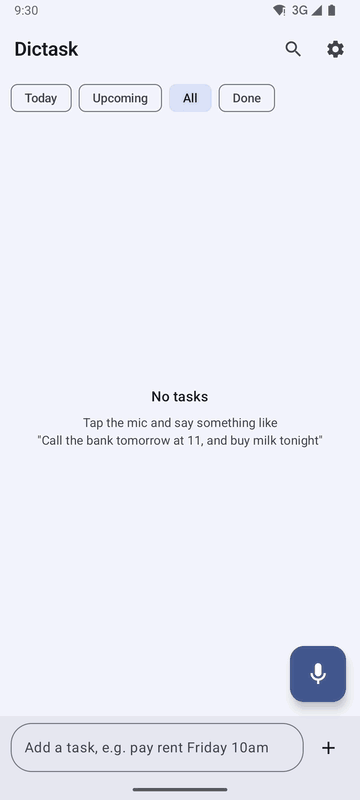
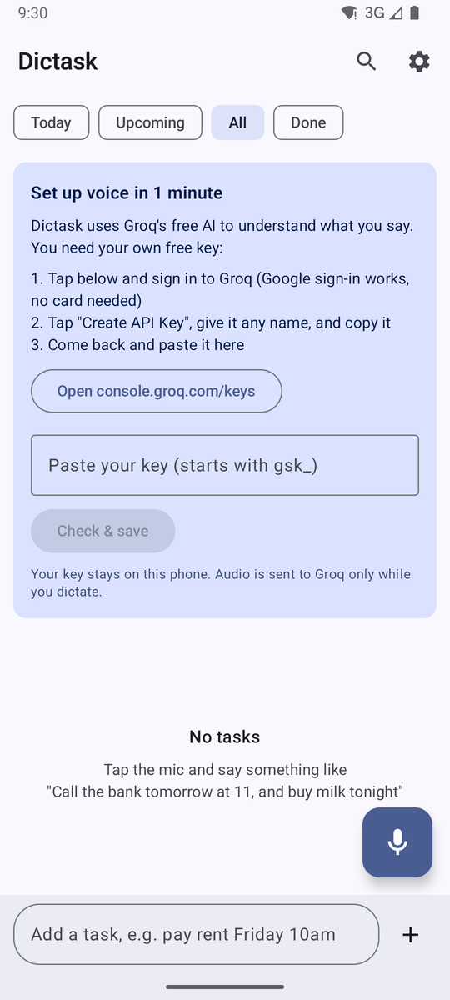
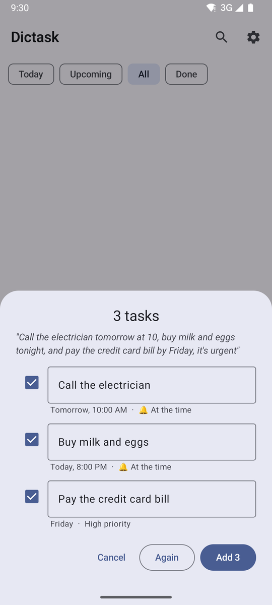
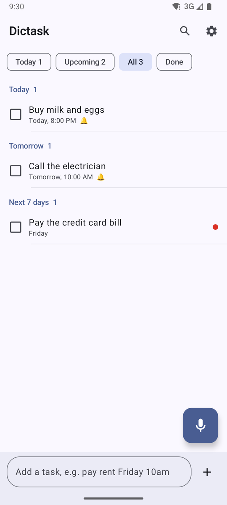
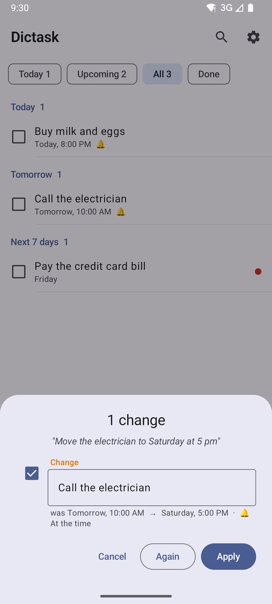
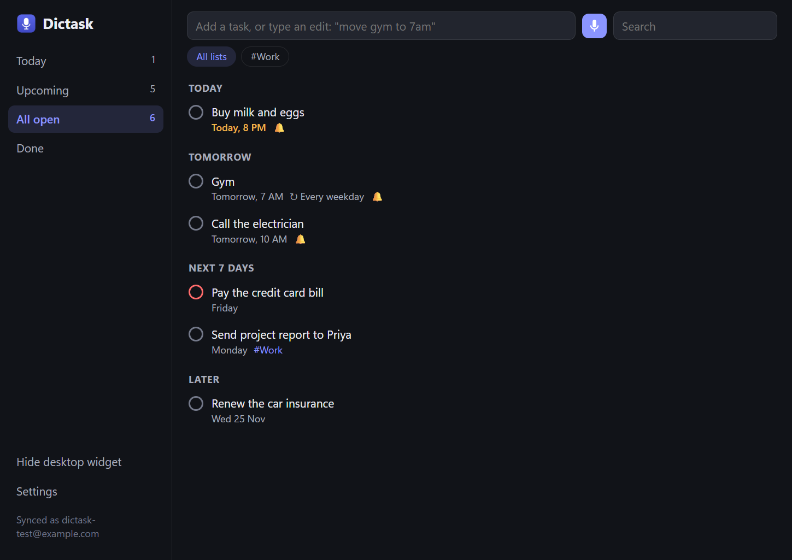
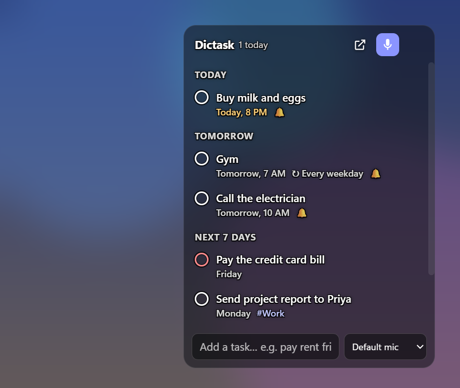
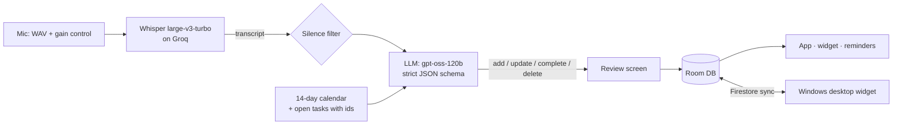

# Dictask: say it once, it's on your list

**The problem:** tasks pop into your head while you're walking, cooking or driving. Typing them into a
to-do app with dates, times and lists is slow enough that you don't, and then they're forgotten.

**The solution:** press one button and talk the way you'd talk to a person:

> *"Call the electrician tomorrow at 10, buy milk and eggs tonight, and pay the credit card bill by
> Friday, it's urgent"*

Dictask turns that into **three separate tasks**, each with its own date, time and reminder, the last one
marked high priority. It also understands edits: *"move the dentist to Friday"*, *"I've paid the rent"*
and *"delete the milk one"* change the tasks you already have.

It runs on **Android** (app, home-screen widget, quick-settings tile) and **Windows** (a transparent
desktop widget), synced live between them.

<p align="center"></p>

| First run | One sentence → 3 tasks | Sorted by when | "Move it to Saturday" |
|---|---|---|---|
|  |  |  |  |

| Windows app | Floating desktop widget |
|---|---|
|  |  |

---

## Install and set up (about 5 minutes)

You need three things: the app, a **free Groq key** (Groq runs the speech and AI models Dictask uses), and,
for the Windows app, a free Dictask account. No credit card anywhere.

| | Android | Windows |
|---|---|---|
| Works on | Android 8.0 or newer | Windows 10 or 11 (64-bit) |
| Download | [`Dictask-1.0.0-android.apk`](https://github.com/HEMANTHreddysolipeta/dictask/releases/latest) (12 MB) | [`Dictask-1.0.0-windows-x64.zip`](https://github.com/HEMANTHreddysolipeta/dictask/releases/latest) (152 MB) |
| Account needed? | No (only for syncing with a laptop) | Yes, free, created in the app |

### Step 1: Get your free Groq key (do this once, use it on every device)

1. Open **[console.groq.com/keys](https://console.groq.com/keys)** in any browser.
2. Sign in. **Continue with Google** is the quickest; email and GitHub also work. No card is asked for.
3. Click **Create API Key**.
4. Type any name (for example `dictask`) and click **Submit**.
5. **Copy the key now.** It starts with `gsk_`, and Groq shows it only once. If you lose it, just create another.
6. Keep it somewhere private (a notes app or password manager). Don't post it publicly: anyone with it can use your
   free Groq quota.

<details>
<summary><b>Step 2a: Install on Android</b> (click to expand)</summary>

1. On your phone, open the [latest release](https://github.com/HEMANTHreddysolipeta/dictask/releases/latest) and tap
   **`Dictask-1.0.0-android.apk`** to download it.
2. When the download finishes, tap **Open** (or find it in **Files → Downloads**).
3. If Android says *"For your security, your phone is not allowed to install unknown apps from this source"*:
   tap **Settings**, turn on **Allow from this source**, then go back.
4. Tap **Install**.
5. If **Google Play Protect** shows *"Unsafe app blocked"* or *"Send app for a security scan?"*: tap
   **More details → Install anyway** (or **Don't send**). This appears because Dictask isn't on the Play Store yet,
   not because anything was found in it.
6. Open **Dictask** and allow **notifications** when asked (needed for reminders).
7. The **"Set up voice in 1 minute"** card is at the top. Paste your Groq key into the box and tap **Check & save**.
   Dictask tests the key with Groq first: you'll see *"Key works. Tap the mic and say your tasks!"*. If the key is
   wrong, it tells you on the spot.
8. Tap the **mic button** and allow the **microphone** the first time. Say something like
   *"Buy milk tonight and call the bank tomorrow at 11"*, check the review screen, and tap **Add**.

**Optional extras**
- **Home-screen widget:** long-press an empty spot on your home screen → **Widgets** → **Dictask** → drag it out.
- **Quick-settings tile:** pull down the notification shade → tap the **pencil (edit)** icon → drag
  **Dictate a task** into your tiles.
- **Exact reminder times (Android 12+):** if reminders arrive a few minutes late, open **Settings** in Dictask and tap
  the prompt to allow **Alarms & reminders**.
- **Sync with your laptop:** **Settings → Sync with laptop** → sign in with the same account you made on Windows.

</details>

<details>
<summary><b>Step 2b: Install on Windows</b> (click to expand)</summary>

1. Download **`Dictask-1.0.0-windows-x64.zip`** from the
   [latest release](https://github.com/HEMANTHreddysolipeta/dictask/releases/latest).
2. Right-click the zip → **Extract All…** → choose a folder you'll keep, for example `C:\Users\<you>\Apps\Dictask`.
   (Run it from the extracted folder, not from inside the zip.)
3. Open the folder `Dictask-win32-x64` and double-click **`Dictask.exe`**.
4. If **"Windows protected your PC"** (SmartScreen) appears: click **More info → Run anyway**. This appears because the
   app isn't code-signed yet (a paid certificate), not because anything was found in it.
5. **Create your account:** type your email and a password (6+ characters) and click **Create account**. Next time,
   use **Sign in**. Your tasks are stored in the cloud under this account and only you can see them.
6. The **"Set up voice in 1 minute"** card appears at the top. Click **Open console.groq.com/keys** if you don't have a
   key yet, paste your key, and click **Check & save**. You'll see *"Key works"*.
7. Press **Ctrl+Shift+Space** from anywhere (any app) and say your tasks. Allow the microphone if Windows asks.

**What the app sets up for you**
- A **Start-menu shortcut** (search "Dictask") so you don't need the folder again.
- **Starts with Windows**, with the widget showing after you sign in. Turn this off in **Settings → Start with Windows**.
- A **tray icon** (bottom-right, near the clock; it may be under the **^** arrow). Right-click it for: open Dictask,
  dictate, show or hide the widget, hot corner, widget background, start with Windows, and microphone.
- The **floating widget** is transparent and lets clicks pass through to the app underneath. To bring it to the front,
  flick the mouse into the **top-right corner** of the screen or use the shortcut shown in the tray menu.

</details>

<details>
<summary><b>Step 3: Sync phone and laptop</b> (optional)</summary>

1. On Windows you already have an account (Step 2b, item 5).
2. On the phone: **Dictask → Settings (gear icon) → Sync with laptop** → enter the same email and password → **Sign in**.
3. Tasks now appear on both. Changes sync live while the apps are open, and the phone also checks every 15 minutes in the
   background. If both change the same task, the newest change wins.
4. The Groq key is **not** synced. Paste it on each device (the same key works everywhere).

</details>

<details>
<summary><b>Troubleshooting</b></summary>

| What you see | What to do |
|---|---|
| *"Groq says this key isn't valid"* | Copy the key again from [console.groq.com/keys](https://console.groq.com/keys). It must start with `gsk_` and have no spaces. If unsure, create a new key. |
| *"Groq rate limit hit. Try again in a minute."* | The free tier allows a limited number of requests per minute and per day. Wait a minute; heavy use for a whole day can hit the daily cap, which resets the next day. |
| *"Can't reach Groq"* | Check your internet connection or VPN. |
| It hears nothing or writes nonsense | Speak a little closer to the mic. On Windows, pick the right microphone in **Settings** or the tray menu (**Microphone**). Adding names you use often under **Settings → Words Whisper should know** helps. |
| A task has the wrong date | Edit it on the review screen before adding, or say *"move the … to Friday"*. Dates are copied from a calendar, so tell us in an issue if one comes out wrong. |
| Reminders arrive late on the phone | Allow **Alarms & reminders** (Android 12+) and, on phones that kill background apps, set Dictask's battery usage to **Unrestricted**. |
| Windows: nothing happens on Ctrl+Shift+Space | Another app may already use that shortcut. Use the mic button in the app or widget, or **Dictate a task** from the tray menu. |
| Windows: I can't see the widget | Right-click the tray icon → **Show desktop widget**, or flick the mouse to the top-right corner. |
| Forgot your account password | Password reset isn't built in yet. Create a new account with another email, or open an issue. |

</details>

<details>
<summary><b>Update or uninstall</b></summary>

- **Update (Android):** download the new APK from Releases and install it over the old one; your tasks stay.
- **Update (Windows):** close Dictask from the tray (right-click → **Quit Dictask**), extract the new zip over the old folder,
  and start it again. Your settings and login stay.
- **Uninstall (Android):** long-press the icon → **Uninstall**.
- **Uninstall (Windows):** in Dictask, turn off **Start with Windows**, choose **Quit Dictask** in the tray menu, then
  delete the app folder and the **Dictask** shortcut from the Start menu.
  To remove settings and the saved login too, delete `%APPDATA%\Dictask`.
- **Revoke your Groq key** anytime at [console.groq.com/keys](https://console.groq.com/keys).

</details>

---

## How it works



1. **Record:** uncompressed audio with the phone's automatic gain control, then a volume boost, so even
   a whisper reaches the model at a normal level. Recording auto-stops after about 2 s of silence.
2. **Transcribe:** Whisper (`whisper-large-v3-turbo` on Groq), biased with the person's own vocabulary
   (names, list names, work terms).
3. **Understand:** one LLM call returns a list of actions (`add`, `update`, `complete`, `delete`) under a
   **strict JSON schema**, so the output always parses. It's given a ready-made calendar and the open tasks
   with their ids, so it can edit existing tasks instead of duplicating them.
4. **Review:** each action is shown as New / Change / Done / Delete, and you can untick any of them
   (or turn on "save without review").

## Problems I had to solve

| Problem found in testing | Fix |
|---|---|
| The model got weekdays wrong ("Friday" landed on the wrong date) | Stop asking it to do date maths: the prompt includes a 14-day calendar to **copy dates from**. Every test phrase then came out right. |
| Whisper invents *"Thank you."* on silence, and Groq's `no_speech_prob` is always 0, so it can't be used to catch this | Detect silence from mic amplitude, plus a blocklist of known silence hallucinations |
| Whispered speech came back empty or garbled | Record WAV instead of low-bitrate AAC (which drops breathy detail), switch on AGC and noise suppression, and normalise gain before upload |
| "By 10" said at 5:30 pm came back as 10:00 am, already in the past | Post-processing shifts past times to the next sensible am/pm |
| Free-tier limit of 8K tokens/min | Prompt cut from ~3,000 to ~1,070 tokens; automatic fallback to `gpt-oss-20b` on rate limits |
| Weaker models sometimes "add" a task that should have been an edit | A word-overlap safety net turns a duplicate-looking add into an update of the matching task |
| The home-screen widget showed stale tasks | Collect the database flow inside Glance's `provideContent` so it re-renders on every change |
| *"…and pay the bill by Friday, it's urgent"* made **every** task high priority. Both model sizes did it, and 120b even rewrote each task's words to include "it's urgent", so asking the model for its evidence didn't work | Checked in code instead: each task is located in the original sentence, the sentence is cut into one stretch per task, and a priority survives only if a priority word is in that task's own stretch. Measured on 10 test sentences: gpt-oss-20b **6/10 → 10/10**, gpt-oss-120b **8/10 → 9/10** (the remaining miss is ambiguous phrasing). Unit-tested on both platforms |
| *"Gym every weekday at 7am"* said after 7 am became **7 pm** (the "by 10 means 10 pm" safety net fired even though "am" was said) | The safety net now checks the sentence for an explicit "am" / "a.m." / "in the morning" at that hour; the date logic then moves it to the next weekday |

## Features

- **Many ways to capture:** widget mic button, quick-settings tile, long-press app shortcut, share from any
  app, a "dictate" button on the morning-summary notification, or type ("pay rent friday 10am" works too)
- Today / Upcoming / All / Done views, grouped into Overdue, Today, Tomorrow, Next 7 days, Later
- Lists (`#Work`, `#Shopping`), priorities, repeating tasks (daily, weekdays, weekly, monthly, yearly)
- Exact-time reminders with **Done** and **Snooze 15 min** right in the notification, plus a morning summary
- Swipe to complete or delete, with undo; Material You colours and dark mode
- **Windows widget:** transparent and click-through, floating over your apps. Flick the mouse to the
  top-right corner, or press Alt+Shift+D, to bring it forward. Same voice capture, synced with the phone.

## Tech

| Part | Built with |
|---|---|
| Android | Kotlin, Jetpack Compose (Material 3), Room, WorkManager, Glance widget, AlarmManager |
| AI | Groq: Whisper large-v3-turbo (speech), gpt-oss-120b / 20b (structured output) |
| Sync | Firebase Auth + Firestore (last write wins on `updatedAt`), live listener + 15-minute background pull |
| Desktop | Electron, Firebase JS SDK, koffi (Win32 calls to pin the widget to the desktop) |
| Tests | JUnit (`./gradlew testDebugUnitTest`): priority guard and am/pm detection, with real model outputs as fixtures |

## Privacy

- **Your Groq key** stays on your device; it's never in the app downloads and never sent anywhere except Groq.
- **Audio** goes to Groq only while you dictate, and the local copy is deleted once the tasks are saved.
- **Tasks** live on the phone. If you sign in to sync, they're stored in Firestore under your account, and the
  [security rules](firebase/firestore.rules) only let you read or write your own.

## Build from source (developers)

**Android**

1. Optional: add `GROQ_API_KEY=gsk_...` to `local.properties` so **debug** builds start with your key
   (release builds never include a key; the app asks for one on first run).
2. Create a Firebase project (Email/Password auth + Firestore), add an Android app for
   `com.hemanth.dictask`, and put its `google-services.json` in `app/`. The build needs it; signing in to
   sync is optional. Firestore rules are in `firebase/`.
3. `./gradlew installDebug`

**Windows desktop**

```bash
cd desktop
npm install
npm start
```
